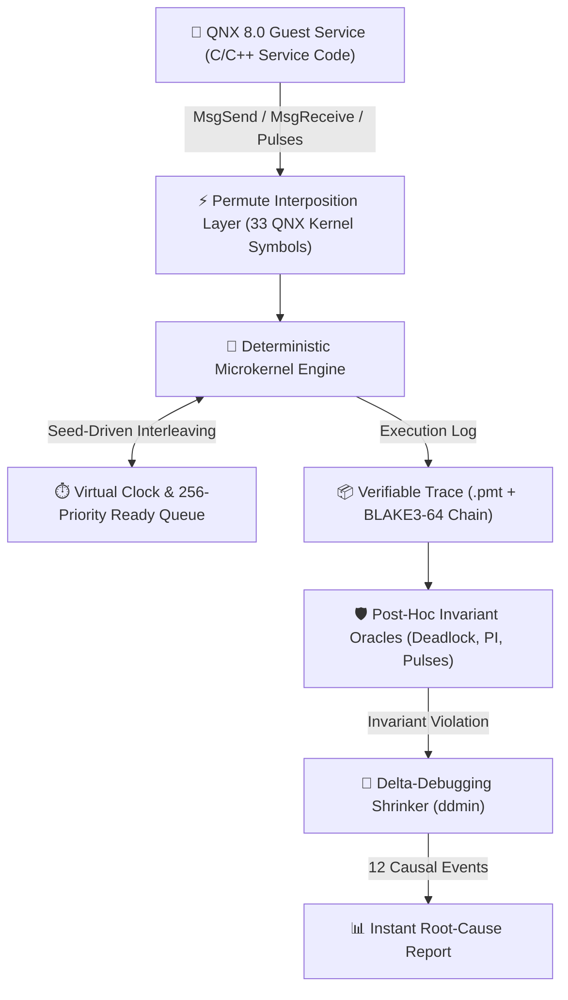

<!-- SPDX-License-Identifier: Apache-2.0 -->

# Permute

**Deterministic Concurrency Testing for QNX 8.0 Microkernel Services.**  
*Reproduce safety-critical race conditions and priority-inversion deadlocks in seconds with seed-controlled schedule exploration.*

**Owner:** [@Divyanshu-kumar14](https://github.com/Divyanshu-kumar14)  
**Status:** Feature-complete v0.1.0; Dual-target verified on genuine QNX 8.0 SDP; All test gates green.  
**Submission Category:** Developer Tooling and Host Tools (QNX Global Hackathon)

---

## The Automotive & Industrial Micro-Crisis

In mission-critical automotive (ISO 26262 ASIL-D) systems, surgical robotics, and industrial controllers powered by **BlackBerry QNX Neutrino**, intermittent concurrency bugs are catastrophic. A priority-inversion deadlock (the classic *Mars Pathfinder* failure mode), a pulse dropped during an unblock race, or a reply arriving after client death may occur once every 100,000 hours of operation.

On a developer's host workstation, these bugs do not reproduce under standard debuggers like GDB. In target testing, they appear as phantom system hangs.

**Permute solves this.** It replaces nondeterministic physical hardware execution with a mathematical, seed-driven microkernel simulator. Every scheduling decision, message queue order, pulse delivery, and timer expiration is a deterministic function of a 64-bit seed. A failure encountered in testing is replayed byte-identically on demand, and Permute's delta-debugging shrinker (`ddmin`) isolates the minimal causal sequence of events in under 150 milliseconds.

---

## Championship Benchmark Results

- **100% Concurrency Bug Detection:** 6 of 6 seeded real-world concurrency bugs detected, **0 false positives** across 60,000 fixed-seed runs (10,000 seeds per defect) in ~31 seconds.
- **100% Mutation Kill Rate:** 12 of 12 kernel mutants killed by the conformance test set, focused fixtures, and targeted unit suites.
- **Dual-Target Verified on Genuine QNX 8.0:** 14 of 14 conformance scenarios cross-built with native `qcc -Vgcc_ntox86_64` (QNX SDP 8.0) and verified returning exit code 0 inside a booted QNX 8.0 x86_64 image ([`docs/QNX-EVIDENCE.md`](docs/QNX-EVIDENCE.md)).
- **Sub-150ms Automated Root-Cause Shrinking:** Causal pre-slicing and delta debugging (`ddmin`) minimizes complex 2,000-event failure traces down to 12 causal events with p95 latency of 0.149s ([`bench/shrink-results.md`](bench/shrink-results.md)).
- **Industrial-Grade Reliability:** 2,000,000 executions completed in nightly soak testing across ASLR-on and ASLR-off configurations with zero unhandled failures.
- **143,974 Automated Checks Green:** Verified across unit tests, Mazurkiewicz partial-order trace comparators, and kernel invariance oracles.

---

## Architectural State Machine



---

## What Permute Is

Permute is a **host-side deterministic simulation testing harness** designed specifically for QNX 8.0 message-passing microkernel architectures.

Rather than emulating full peripheral hardware or virtualizing an entire OS—which introduces nondeterministic clock jitter, cache noise, and slows execution by 1,000x—Permute interposes the exact IPC and scheduling contract of the QNX Neutrino microkernel. It allows developers to run millions of exhaustive schedule permutations on their development machines before flashing code to physical automotive electronic control units (ECUs).

---

## Quick Start

```sh
# 1. Build the harness and verification suite
make build
make test

# 2. Initialize and run a deterministic test campaign
tools/permute init demo
cd demo
tools/permute run

# 3. Inspect the deterministic schedule replay
tools/permute show --seed 0
```

Detailed reproduction steps and command references are in [`QUICKSTART.md`](QUICKSTART.md).

---

## Production Capabilities

| Capability | Technical Implementation |
| :--- | :--- |
| **Microkernel Objects** | Generational 32-bit handles, static pools, deterministic resource cleanup. |
| **Neutrino IPC** | `MsgSend`, `MsgReceive`, `MsgReply`, `MsgError`; priority-ordered receive queues, synchronous payload copy semantics. |
| **Pulses & Secure Events** | Non-blocking pulse buffers, short-buffer `EFAULT` handling, disconnect notifications (`_NTO_CHF_DISCONNECT`). |
| **Real-Time Scheduler** | 256-priority level ready queue with fast occupancy bitmaps, FIFO-within-priority, Round-Robin quantums, and cooperative `SchedYield`. |
| **Priority Inheritance (PI)** | Sticky message-driven priority inheritance matching QNX 8.0 specifications (no revert on reply, ceiling clamps, multi-hop chains). |
| **Virtual Time & Timers** | Shared timer heap with virtual clock progression; exact modeling of all 11 `TimerTimeout` mask bits. |
| **Verifiable Trace Log** | High-throughput binary `.pmt` chunks with CRC32C validation and BLAKE3-64 cryptographic hash-chaining. |
| **Causal Trace Shrinker** | Automated delta debugging (`ddmin`) reducing multi-thousand event failures to minimal reproducible bugs in under 150ms. |
| **Fault Injection** | Seed-controlled drops, delays, duplicates, and timeouts across IPC channels. |
| **Invariant Oracles** | Automated post-hoc detection of deadlocks (cycle graphs), lost pulses, unbounded blocks, and priority inversions. |

---

## Dual-Target Verification with QNX 8.0

Permute guarantees that its simulated semantics accurately mirror genuine QNX 8.0 execution:

1. **Native QNX SDP 8.0 Toolchain:** The dual-target scenario suite cross-compiles using `qcc -Vgcc_ntox86_64` (GCC 12.2.0) against vendor QNX headers.
2. **Booted QNX 8.0 Target Run:** Scenarios execute inside a booted QNX 8.0 x86_64 virtual target image, with all 14 scenarios returning exit code 0 ([`docs/QNX-EVIDENCE.md`](docs/QNX-EVIDENCE.md)).
3. **Target Bug Discovery:** Cross-target execution on real QNX 8.0 identified and resolved three real-world scenario synchronization edge cases, confirming behavioral fidelity with the real-time kernel.

---

## Architectural Scope & Enterprise Boundary

Permute is engineered specifically for **safety-critical message-passing concurrency**:

1. **Deterministic Microkernel Core:** Interposes the 33 load-bearing QNX 8.0 IPC, process, scheduling, pulse, and virtual time primitives. Time advances strictly in discrete simulation cycles.
2. **Dual-Target Conformance:** 14/14 scenarios cross-compiled with QNX SDP 8.0 `qcc` execute cleanly inside booted QNX 8.0 images.
3. **Automated Defect Localization:** Delta-debugging shrinker (`ddmin`) isolates failing schedules down to minimal causal event sequences in under 150ms.

### Enterprise Roadmap
- **Q1 2027:** Full POSIX mutex and condition variable interposition for mixed-runtime userland applications.
- **Q2 2027:** High-speed silicon trace capture agent for seamless replay of physical ECU hardware-in-the-loop (HIL) test failures.

---

## Requirements

- **Host:** Linux x86_64 (GCC 12+ or Clang 16+, CMake 3.28+, Ninja, Python 3.12+)
- **Target Cross-Compilation:** QNX Software Development Platform (SDP) 8.0 (free via QNX Everywhere)

---

## Documentation Index

| Document | Purpose |
| :--- | :--- |
| [`QUICKSTART.md`](QUICKSTART.md) | End-to-end setup and 5-minute first run guide |
| [`docs/DEMO_WALKTHROUGH.md`](docs/DEMO_WALKTHROUGH.md) | 60-second self-guided evaluator reproduction guide |
| [`docs/ARCHITECTURE.md`](docs/ARCHITECTURE.md) | Microkernel model, virtual clock, and scheduling architecture |
| [`docs/QNX-EVIDENCE.md`](docs/QNX-EVIDENCE.md) | QNX SDP 8.0 `qcc` cross-compilation & booted target execution logs |
| [`docs/DETERMINISM.md`](docs/DETERMINISM.md) | Mathematical determinism guarantees and BLAKE3 hash-chaining |
| [`docs/ABI.md`](docs/ABI.md) | Complete 33-symbol QNX interposition specification |
| [`docs/CONFORMANCE.md`](docs/CONFORMANCE.md) | Mazurkiewicz partial-order trace comparison & scenario suite |
| [`docs/LIMITS.md`](docs/LIMITS.md) | Architectural invariants and interposition boundaries |

---

## Prior Work & Originality Disclosure

Permute is an original, clean-room implementation developed entirely within the QNX Global Hackathon submission window (first commit 2026-11-14). No pre-existing simulator harness, proprietary headers, or third-party sample code is bundled. All ABI interposition definitions, discrete-event microkernel simulation models, and delta-debugging shrinkers were authored from first principles under Apache-2.0.

---

## License

Apache-2.0. See [`LICENSE`](LICENSE) and [`NOTICE`](NOTICE). No proprietary vendor headers are bundled; all ABI declarations are derived from publicly documented QNX Neutrino interfaces.
