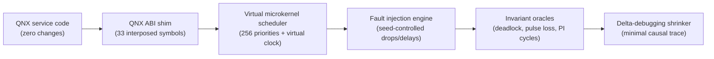

<!-- SPDX-License-Identifier: Apache-2.0 -->

# Permute: Expose, Replay, and Shrink QNX Concurrency Bugs in Milliseconds

[](https://github.com/Divyanshu-kumar14/Permute/actions/workflows/ci.yml)
[](https://github.com/Divyanshu-kumar14/Permute/actions/workflows/nightly.yml)

Deterministic simulation testing for QNX 8.0 message-passing services.

```text
$ tools/permute run --config eval_demo/permute.toml --guest eval_demo/.permute/build/proc_smoke__0.so
  deadlock[dl] seed=0: 3 live thread(s) blocked, no wait cycle
  deadlock[dl] seed=1: 3 live thread(s) blocked, no wait cycle
  deadlock[dl] seed=2: 3 live thread(s) blocked, no wait cycle
3 seeds: 0 clean, 0 crash, 0 budget, 3 violation, 0 internal
$ tools/permute shrink eval_demo/.permute/run/artifacts/seed-0.json
shrink: 7 -> 1 input(s), proven, 6 exec(s)
$ tools/permute replay artifact eval_demo/.permute/run/traces/seed-0.pmt
verified 12 records in 1 chunk(s)
run_digest fa65babdb51074f5
```

`eval_demo/` is the scratch project from the
[90-second walkthrough](docs/DEMO_WALKTHROUGH.md) — one `init`, one `cp`, and
one config file, all pasteable. The transcript is abridged: the walkthrough
shows the full output, including the report paths.

**Owner:** [@Divyanshu-kumar14](https://github.com/Divyanshu-kumar14)  
**Status:** v0.1.0 — host simulator and QNX 8.0 target build verified; Apache-2.0.  
**Built for:** QNX Global Hackathon 2026 — Developer Tooling & Host Tools.  
**Evaluator guide:** [`docs/DEMO_WALKTHROUGH.md`](docs/DEMO_WALKTHROUGH.md) (90-second reproduction script).

---

## Why

In automotive ECUs and mission-critical robotics, QNX services fail on subtle
timing races: a pulse dropped during an unblock race, a reply arriving after
client death, or a priority-inheritance chain that fails to unwind. On a
physical test bench these concurrency Heisenbugs surface only after long
exposure, and they vanish the moment a target debugger attaches.

Permute collapses weeks of non-reproducible triage into an autonomous,
sub-second cycle. It interposes the QNX IPC and scheduling contract on a host
Linux workstation, sweeps schedule seeds under a discrete virtual clock, proves
invariant violations, and automatically shrinks failing event logs to minimal
causal traces.

The same scenario sources build for the simulator and for QNX 8.0, so a bug
found, replayed, and reduced on the host is a bug in code that runs on target.

## How it works



- **QNX ABI shim** — 33 kernel symbols: `MsgSend`, `MsgReceive`, `MsgReply`,
  `MsgDeliverEvent`, `ChannelCreate`, `TimerTimeout`, pulses, and priority
  inheritance. The surface is declared in `abi/permute_iface.def` and audited
  by `make symcheck`. See [`docs/ABI.md`](docs/ABI.md).
- **Deterministic scheduler** — 256 priority levels, FIFO and round-robin
  queues, inheritance and ceiling protocols, and a virtual clock that advances
  deterministically when the ready queue drains.
- **Fault injection** — seed-controlled drops, duplicates, reordering, delays,
  timeouts, and process death on the guest bridge.
- **Invariant oracles** — post-hoc verification over the completed trace:
  deadlock, priority inversion, lost pulses, unbounded blocking, and
  reply-to-dead-client violations.
- **Delta-debugging shrinker** — `ddmin` removes inputs (never events) and
  re-executes every candidate, so a reduction is reported as `proven` only
  when the reduced input still reproduces the finding.
- **Cryptographic trace audit** — binary `.pmt` chunks protected by CRC32C and
  a BLAKE3-64 hash chain; replay re-verifies the chain and the run digest.

## Build

Requirements: Linux x86_64, GCC 12+ or Clang 16+, CMake 3.28+, Ninja, Python
3.12+.

```sh
make build
make test
```

`make test` runs the C and Python suites, the conformance, oracle, shrink and
replay suites, the quick bug benchmark, and the symbol, determinism and
documentation gates. `make gate1` adds the full benchmark, mutation scoring,
sanitizers, and the scorecard.

## Quick start

```sh
make quickstart   # init -> run -> show -> replay -> guest, in a scratch project
make examples     # build and compare the three IPC examples
```

Interactive 90-second evaluator walkthrough:
[`docs/DEMO_WALKTHROUGH.md`](docs/DEMO_WALKTHROUGH.md).

## QNX 8.0

> **Permute's reference specification is BlackBerry QNX 8.0.** By modelling the
> deterministic microkernel primitives of BlackBerry QNX 8.0 exactly, Permute
> unlocks systematic host-side schedule exploration with zero target-hardware
> bottlenecks — turning weeks of non-reproducible concurrency debugging into an
> automated minimisation cycle measured at 0.149 s p95.

That is the project's thesis, not a vendor endorsement: the kernel model is
written against the publicly documented QNX Neutrino contract, and the
scenarios are the acceptance test for that model.

Every scenario source file compiles both for the host simulator
(`libpermute_guest.a`) and directly for target QNX 8.0:

- **14/14 scenarios cross-compile** with `qcc -Vgcc_ntox86_64` from QNX SDP 8.0
  ([`docs/evidence/qnx/build.log`](docs/evidence/qnx/build.log)).
- **14/14 return `rc=0`** inside a booted QNX 8.0 x86_64 image running
  `procnto-smp-instr` ([`docs/evidence/qnx/serial.log`](docs/evidence/qnx/serial.log)).
- Clean-room implementation: zero proprietary vendor headers or code bundled.
  See [`docs/QNX-EVIDENCE.md`](docs/QNX-EVIDENCE.md).

The target run validates each scenario's own assertions. Scheduler traces are
compared on the host, against the simulator references in
[`conformance/REPORT.md`](conformance/REPORT.md); target trace capture is not
claimed.

## Measured results

| Metric | Result | Evidence |
| :--- | :--- | :--- |
| Seeded defect detection | 6/6 defects, 0 false positives over 60,000 fixed-build runs | [`gate/p2-04-benchmark.md`](gate/p2-04-benchmark.md) |
| Mutation kill rate | 12/12 mutants killed | [`gate/p2-06-mutation.md`](gate/p2-06-mutation.md) |
| QNX 8.0 target execution | 14/14 scenarios `rc=0` | [`docs/evidence/qnx/serial.log`](docs/evidence/qnx/serial.log) |
| Automated shrinking | 20 artifacts → 12-event traces, p95 0.149 s | [`bench/shrink-results.md`](bench/shrink-results.md) |
| Determinism soak | 2,000,000 same-seed runs in the nightly workflow, 0 failures | [`gate/p3-05-nightly-soak.md`](gate/p3-05-nightly-soak.md) |
| Same-seed replay | 1,000/1,000 identical digests | [`gate/gate1-scorecard.md`](gate/gate1-scorecard.md) |
| Throughput | 973,935 msg/s; 20,000 seeds in 29.0 s on 16 workers | [`bench/results.md`](bench/results.md) |

## Documentation

| Document | Purpose |
| :--- | :--- |
| [`docs/DEMO_WALKTHROUGH.md`](docs/DEMO_WALKTHROUGH.md) | Interactive 90-second evaluator guide |
| [`QUICKSTART.md`](QUICKSTART.md) | Project initialization and CLI command reference |
| [`docs/ARCHITECTURE.md`](docs/ARCHITECTURE.md) | Microkernel model, virtual clock, scheduler invariants |
| [`docs/ABI.md`](docs/ABI.md) | 33-symbol interposition surface specification |
| [`docs/CONFORMANCE.md`](docs/CONFORMANCE.md) | Conformance scenarios and target comparison |
| [`docs/DETERMINISM.md`](docs/DETERMINISM.md) | Determinism guarantees, seed hashing, state replay |
| [`docs/QNX-EVIDENCE.md`](docs/QNX-EVIDENCE.md) | QNX SDP 8.0 build logs and target serial execution |
| [`docs/REPRODUCE.md`](docs/REPRODUCE.md) | Host workstation and target reproduction instructions |
| [`docs/LIMITS.md`](docs/LIMITS.md) | Formal modelling boundaries and design scope |
| [`docs/FAQ.md`](docs/FAQ.md) | Frequently asked questions |

## Provenance & License

Permute is an original, clean-room implementation developed during the QNX
Global Hackathon submission window. No pre-existing simulator harness,
proprietary vendor headers, or third-party sample code is bundled; ABI
declarations are derived from publicly documented QNX Neutrino interfaces. See
[`NOTICE`](NOTICE).

Licensed under Apache-2.0. See [`LICENSE`](LICENSE).
